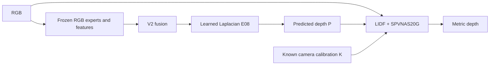

# RGB Fusion + Learned Laplacian + LIDF–SPVNAS

This project estimates metric depth from **RGB and known camera calibration**.
Its frozen first stage combines the trained V2 fusion model with the learned
Laplacian adapter at epoch 8. The second stage refines its predicted depth with
LIDF and the official specialized SPVNAS20G branch.

**Release preparation is in progress.** The final second-stage checkpoint will
be selected by evaluating all 80 epochs on all 1,226 ClearGrasp images and
minimizing native-resolution, per-image **transparent-region MAE**. This is
explicitly **post hoc test-set selection**, not an independent test estimate.
`configs/release.json` rejects inference until selection and portability checks
have completed. The previously reported E63 result was selected on the 704-image
validation set; it is not evidence that E63 wins this new comparison.

## Pipeline



Deployment supplies no sensor depth, GT depth, or GT transparent mask. SPVNAS
uses the official searched network at a fixed **5 cm** voxel scale; occupied
voxels and point mappings vary with the input. LIDF's ray-intersection grid is
a separate structure.

## Repository layout

| Path | Purpose |
|---|---|
| `src/transparent_depth/` | Portable stage loaders, two-environment CLI, asset verification |
| `src/native_fusion/`, `src/laplacian_train/` | First-stage model and learned Laplacian mathematics |
| `src/v2_lidf/` | LIDF/SPVNAS numerical core |
| `third_party/` | Pinned upstream source and its original licenses |
| `configs/` | Model, training, and selected-release settings |
| `provenance/` | Asset hashes, source revisions, and reproducibility records |
| `scripts/` | Installation, selection, export, and validation commands |
| `reports/` | Selection table and release verification evidence |
| `artifacts/` | Downloaded model files; excluded from Git |

Historical experiment directories and cached predictions are not deployment
dependencies. Large weights are stored outside ordinary Git history.

The Chinese [architecture and data-flow guide](docs/ARCHITECTURE.zh-CN.md)
explains prediction inputs, GT supervision, curriculum mixing, and selection.

## Environments

The audited stages used different PyTorch versions. Keeping two environments
preserves those execution paths:

| Stage | Python | PyTorch / torchvision |
|---|---|---|
| Frozen fusion + Laplacian | 3.11 | 2.8.0+cu128 / 0.23.0+cu128 |
| LIDF + SPVNAS | 3.10 | 2.1.2+cu121 / 0.16.2+cu121 |

Stage two requires the pinned TorchSparse source revision and CUDA 12.1 build
toolchain, not an arbitrary package carrying the same version string. The
installation instructions and locked requirements are kept with each stage.
See [Stage1 reproduction](docs/stage1_reproduction.md) and
[Stage2 runtime and training](docs/STAGE2_RUNTIME.md).

Install this checkout in both environments with `python -m pip install -e .`.
The top-level package itself imports neither PyTorch nor CUDA. Model modules are
loaded only by their corresponding environment.

## Assets

User-trained weights are distributed through this private repository's release.
Official upstream models are downloaded at pinned revisions, under their
respective licenses. Authenticate `gh` for private release files and, where
required, Hugging Face for upstream models, then run:

```bash
python scripts/fetch_assets.py \
  --manifest provenance/release_assets.json \
  --asset-root /data/transparent-depth-assets

python scripts/fetch_assets.py \
  --manifest provenance/release_assets.json \
  --asset-root /data/transparent-depth-assets --verify-only
```

Every asset is checked by byte size and SHA-256 before model loading. A
repository clone contains source and manifests, not the ClearGrasp dataset or
large weight files.

## Inference

Create a calibration JSON file containing the native RGB image's 3×3 intrinsic
matrix, then select the physical GPU explicitly:

```bash
export CUDA_DEVICE_ORDER=PCI_BUS_ID
export CUDA_VISIBLE_DEVICES=5

transparent-depth infer \
  --rgb /data/example.png --intrinsics /data/K.json \
  --output /data/predicted_depth.npy \
  --asset-root /data/transparent-depth-assets \
  --runtime-cache /data/transparent-depth-runtime \
  --stage1-python /envs/fusion/bin/python \
  --stage2-python /envs/lidf/bin/python \
  --device cuda:0
```

Here `cuda:0` is physical GPU 5 because of the visibility setting. Both stages
inherit the same restriction. Output depth is a native-resolution float32 NumPy
array in metres. A JSON sidecar records input/config/weight provenance.
The writable runtime directory holds isolated JIT files and a working copy of
the authenticated FlexGEMM kernel configuration; the frozen asset is preserved.

The first stage writes predicted depth to a temporary intermediate file. The
second stage receives that prediction, RGB, and calibration. GT labels are not
accepted by the inference CLI.

## Training and evaluation protocol

To reuse the audited ClearGrasp identities, calibration and split, run
`python scripts/prepare_cleargrasp_rosters.py --data-root /your/data --output outputs/cleargrasp`.
The [reference-roster guide](data/cleargrasp_reference/README.md) describes the
required dataset layout and the Stage1 prediction / Stage2 preparation commands.
The compressed reference contains metadata only; images and supervision arrays
remain in your dataset directory.

The historical run used 45,453 training identities, 704 validation identities,
and 80 full epochs. Training background input followed 20 epochs of GT
background, 30 of linear transition, and 30 of fully predicted depth. Transparent
input depth always came from the frozen first stage, while GT depth remained
the supervision target. The released training code documents initialization,
sampling, precision, and continuous optimizer/scheduler state.

The earlier 60-epoch, 20/20/20 curriculum was a separate pre-SPVNAS experiment.
This repository preserves the later approved 80-epoch, 20/30/30 SPVNAS protocol.
Fresh 3-GPU and 8-GPU configurations preserve its model and loss mathematics;
neither promises the exact scores or stochastic trajectory of the historical run.

The run changed from eight GPUs to three after epoch 29. Its historical record
therefore contains effective batches 32 then 30, and 1,421 then 1,516 optimizer
updates per epoch. Model weights, Adam, and StepLR state were restored; the
different batch topology does not reproduce the same subsequent numerical
trajectory. The original strict GPU numerical-repeatability failure remains
documented rather than being relabeled as a pass.

The new publication checkpoint is selected on **all 1,226 images** using the
user-requested transparent-region MAE criterion. Reports retain all-image,
transparent, and background metrics, real/synthetic breakdowns, and the original
521-image test subset. The full 1,226 set includes images previously used for
validation, so these results must not be described as held-out generalization.

## Verification before upload

The current `training_release` audit must establish:

1. Complete 80-checkpoint × 1,226-image selection, with authenticated identities.
2. Complete 1,226-image same-P parity between the original winning model and
   portable Stage2, followed by the same native depth and geometry evaluation.
3. Three actual old/new live RGB Stage1 cases, a relocated-checkout case, and
   twelve fresh RGB-only predictions using declared assets. Original CUDA
   `scatter_add` operators and weights are retained: 42 upstream/input fields
   must be exact; four metric-depth outputs must each have maximum absolute
   difference ≤5e-5 m and mean absolute difference ≤1e-6 m. Nine nonmetric
   intermediate fields are diagnostic only, with matching schema and finite
   values. These fixed limits were explicitly accepted by the user; original
   zero-tolerance failures and repeatability evidence remain available.
4. Genuine single-GPU and two-GPU training acceptance using the fresh P batch:
   nine optimizer updates per run covering all three curriculum phases, an
   epoch-boundary interruption/resume, finite gradients, updates to every
   trainable parameter group, and authenticated source/asset identities.
5. A clean Git tree excluding dataset files, caches, credentials, and large
   weights, with preserved third-party license and attribution files.

Results and command receipts belong in `reports/`; an unfinished check is not a
release pass.

This profile does **not** rerun live RGB experts on all 1,226 images. Its full
result tables contain the historical cached-P chain and portable same-P chain;
the live cases and tiny training runs are functional acceptance, not a new full
quality experiment or a guarantee of equal scores after retraining.
`scripts/build_release_report.py` retains the stricter default `full_live`
profile, which requires a separate full live 1,226-image result. The explicit
`--verification-profile training_release` instead requires `--stage1-acceptance`,
`--single-training-acceptance`, and `--ddp-training-acceptance`; no live metrics
are synthesized. `--asset-root` permits externally stored verified weights.

Install `pytest` in both environments, then run their CPU checks explicitly:

```bash
bash scripts/test_cpu.sh /envs/fusion/bin/python /envs/lidf/bin/python
```

This hides CUDA for both test groups. Actual CUDA parity, training/resume, and
the full 1,226-image measurements have separate receipts.

`sweep_checkpoints.py`, `run_sweep.py`, `sweep_verify.py`, and
`evaluate_selected.py` are frozen audit tools for the historical 80-checkpoint
comparison. Their receipts bind the exact source and original experiment
contracts. Replaying that audit requires its recorded checkpoint/data inputs;
the production inference and fresh-training entrypoints do not call these tools.

## Licensing

Upstream components retain their own licenses. In particular, the vendored LIDF
code is subject to NVIDIA's noncommercial research/evaluation terms, TransNormal
uses CC BY-NC 4.0, and DINOv3 has its own license. Other components include MIT,
Apache-2.0, and BSD-licensed code. This repository does **not** relicense all
components under MIT. See the bundled license texts and third-party notices.
The component index is [THIRD_PARTY.md](THIRD_PARTY.md).
